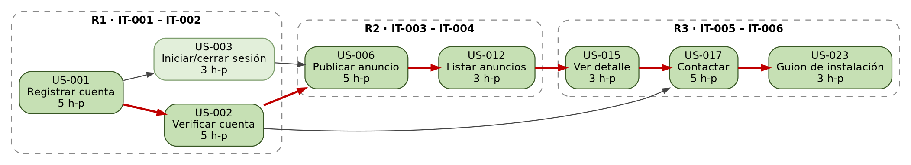
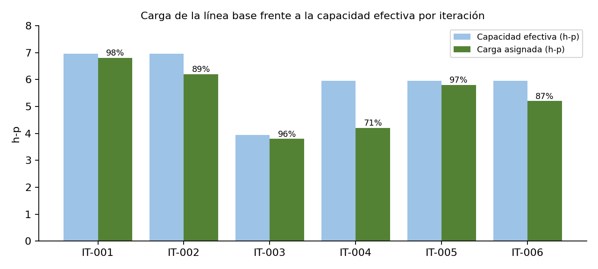

# Trabajo 1 · Planificación del proyecto ErasmusNest

**Asignatura:** Gestión de Proyectos Software (UEx, 2026/27) · **Grupo:** GC04 · **Empresa:** Practical Software\
**Equipo:** Hugo (Product Owner), Gled (Tech Lead) y José (Scrum Master) · **Fecha:** 16/10/2026 · **Versión 2 (reevaluación):** 05/11/2026\
**Repositorio:** <https://github.com/UniExtremadura/Proyecto_GC04> (etiqueta `entrega-trabajo1-v2`; la entrega original es `planificacion-v1`) · **Wiki:** <https://github.com/UniExtremadura/Proyecto_GC04/wiki>

## Resumen

Practical Software planifica **ErasmusNest**, una plataforma web para que los estudiantes de la UEx que se van de movilidad subalquilen su habitación a otros estudiantes verificados. El cliente es la Delegación de Estudiantes UEx.

El catálogo tiene **24 historias en 5 épicas** y, estimado en Planning Poker, suma **84 h-p**. Esta versión 2 rehace la planificación tras la evaluación del profesor (apartado *Mejoras tras la evaluación*). Con las horas reales del equipo (7, 7 y 9 h a la semana), la capacidad efectiva en las 6 iteraciones es de **77,32 h-p**. La línea base pasa a ser de **18 historias *Must* y *Should*** (DEC-025), **69 h-p, el 89 % de la capacidad**, con 3 historias por iteración.

La planificación por persona e iteración no tiene sobreasignaciones, respeta todas las dependencias por fechas y deja un margen de 8,32 h-p. Cada historia tiene su fecha de inicio y de fin, y las reuniones están en su día y hora. Se ha trasladado a ProjectLibre en dos vistas, por sprints y por épicas. El coste planificado es de **4.368,32 €**: 2.405,20 € de desarrollo, 1.326,80 € de gestión y **636,32 € de reserva de imprevistos**. La planificación es **viable**, sin celdas persona × iteración ajustadas (la holgura mínima es de 0,21 h-p).

Este informe sigue los 15 puntos de «Planificación Práctica 1». El detalle está en el repositorio y en la Wiki, que es donde se justifica cada decisión (DEC-001…DEC-025).

| Punto del enunciado | Apartado |
|---|---|
| Cambios de la versión 2 | Mejoras tras la evaluación |
| Empresa · Equipo · Team charter · Idea | 1 · 2 · 3 · 4 |
| Modelo de proceso · Proceso | 5 · 6 |
| Requisitos · Relaciones · Granularidad | 7 · 8 · 9 |
| Esfuerzo del equipo · Priorización | 10 · 11 |
| Estimación de requisitos · Estimación del proyecto | 12 · 13 |
| Planificación · Coste | 14 · 15 |
| Además: riesgos, uso de la IA y viabilidad | 16 · 17 · 18 |

## Mejoras tras la evaluación

La primera versión (16/10/2026) obtuvo un 8,5. El profesor valoró los requisitos, la DoR y la DoD, el Excel de capacidad, coste y viabilidad, y la Wiki. Señaló cinco puntos de mejora, que esta versión corrige. El detalle está en la página *Mejoras tras la evaluación* de la Wiki y en **DEC-025**.

| Comentario del profesor | Qué hemos cambiado | Dónde |
|---|---|---|
| Las tareas de gestión duran el sprint entero y la review y la retrospectiva se reparten cada semana. ProjectLibre no muestra cuándo se reúne el equipo | Cada reunión está en su día y hora: Sprint Planning y refinamiento los miércoles de 16:00 a 16:45, y review y retrospectiva (50 min) los martes 03/11, 17/11 y 01/12 de 17:00 a 17:50. Ya no se prorratean: la review y la retro solo restan capacidad en IT-002, IT-004 e IT-006 | Apartados 6, 10 y 14.2 · Excel, hoja *Capacidad* (fila 23 y tabla de fechas) · ProjectLibre v3 |
| Lo mismo ocurre con las historias de usuario | Cada historia tiene fecha de inicio y de fin dentro de su sprint (de 2 a 5 días) y ninguna dura el sprint entero. El Excel comprueba que las predecesoras terminan antes y que las fechas caen dentro de su iteración | Apartado 14.1 · Excel, hoja *Planificación* (columnas *Inicio* y *Fin*) · ProjectLibre v3 |
| El coste suma desarrollo y gestión, pero no pone precio a la reserva de imprevistos | Fila nueva «Reserva de imprevistos»: 17,48 h × tarifa de cada rol = **636,32 €**. El coste total con reserva es de **4.368,32 €**, igual en el Excel y en ProjectLibre, que tiene una tarea de reserva en cada sprint | Apartados 14.3 y 15 · Excel, hoja *Coste* · riesgos RSK-01 y RSK-09 |
| Dejad constancia de qué cambiasteis vosotros con respecto a la IA y por qué | Columna nueva «Qué cambió el equipo y por qué» en el registro de hallazgos y de usos de IA, y apartado nuevo con los cambios del equipo sobre las propuestas de la IA | Apartado 17 · `registro-ia.md`, apartados 3, 4 y 5 |
| La carga por historia y sprint es muy baja: solo una o dos historias por sprint | Capacidad con las horas reales (antes se contaban solo las horas fuera de clase) y línea base de 18 historias *Must* y *Should*, **3 por sprint**, sin historias repartidas en dos iteraciones | Apartados 10, 11, 13 y 14 · DEC-025 |

## 1. Empresa

**Practical Software** es una consultora de desarrollo de tres personas. Diseña y construye productos digitales a medida para organizaciones pequeñas y medianas, como asociaciones, instituciones educativas o negocios locales, que necesitan una solución concreta entregada en plazos cortos. Su propósito es convertir la necesidad real de un cliente en un producto mínimo viable bien planificado, medible y trazable.

Ofrece estos servicios:

- desarrollo web a medida por encargo de un tercero;
- definición de producto (visión, alcance, objetivos y catálogo priorizado);
- gestión ágil con Scrum;
- estimación de esfuerzo, coste y línea base;
- control de calidad, pruebas y despliegue del incremento.

Ficha completa: `docs/organization/empresa.md` (DEC-004).

## 2. Equipo

| Miembro | Rol | Responsabilidad principal |
|---|---|---|
| Hugo | Product Owner | Visión, valor, stakeholders, alcance, prioridad y criterios de aceptación |
| Gled | Tech Lead | Coherencia técnica, descomposición en tareas, dependencias, restricciones y riesgos técnicos |
| José | Scrum Master | Proceso, ceremonias, impedimentos, acuerdos y trazabilidad |
| Los tres | DevOps/QA | Pruebas, entornos, integración y guion de instalación, repartidos en cada Sprint Planning |

El enunciado prevé equipos de 4 o 5 personas. Somos 3, así que, siguiendo la indicación del profesor, DevOps/QA no tiene un responsable único: se reparte de forma equilibrada y el reparto de cada sprint consta en su acta (DEC-002).

## 3. Team charter

El team charter (`docs/organization/team-charter.md`, versión 1.2) recoge **20 acuerdos medibles** en siete bloques:

- **Comunicación (1–3):** revisar WhatsApp y Discord cada día laborable y responder en 24 h (48 h en fin de semana). WhatsApp es el canal asíncrono y Discord el técnico y de voz.
- **Reuniones (4–6):** reunión fija los miércoles de 45 min (planning y refinamiento) con acta en la Wiki el mismo día, daily asíncrona antes de las 22:00, y review y retrospectiva al cierre de cada release, con 1 o 2 acciones de mejora con responsable y fecha.
- **Disponibilidad y ausencias (7–8):** cada miembro respeta el horario declarado en la capacidad; las ausencias se avisan con 24 h de antelación.
- **Decisiones (9–11):** el PO decide sobre producto y alcance, el TL sobre técnica, y toda decisión relevante se registra el mismo día.
- **Conflictos y feedback (12–13):** si no hay acuerdo en 48 h, decide el TL o el PO; el feedback es directo, en el canal o en la PR.
- **Calidad y herramientas (14–16):** límite de una tarea activa por persona, ningún cambio en `main` sin PR revisada por otra persona, y el repositorio como única fuente oficial.
- **Profesorado y señales de alerta (17–20):** qué hacer ante retrasos de más de 2 días, bloqueos de más de 24 h, incumplimientos repetidos o falta de implicación.

El charter se revisó dos veces para alinearlo con los enunciados y con el proceso (DEC-017 y DEC-019).

## 4. Idea de producto

**Problema.** Los estudiantes de la UEx que se van de Erasmus o de prácticas dejan su habitación vacía o la subalquilan por canales informales, como grupos de WhatsApp, Facebook o el boca a boca. Así no saben si la otra parte es estudiante de verdad, cuesta encontrar opciones que encajen con unas fechas concretas y no hay ninguna garantía.

**Propuesta de valor.** ErasmusNest reúne en un solo lugar tres cosas: la **verificación institucional** por correo de la UEx, la **publicación y búsqueda** de habitaciones por fechas y zona, y el **contacto** dentro de la plataforma. Esto aporta confianza, centralización y un estado de cada anuncio siempre visible (`specs/product/mission.md`).

**Stakeholders:**

- SH-01: Delegación de Estudiantes UEx, el cliente. Valida el producto y acepta el incremento en cada release; en la asignatura la representa el profesorado.
- SH-02 y SH-03: estudiantes oferentes y demandantes.
- SH-04: profesorado.
- SH-05: el propio equipo.

**Objetivos y métricas** (`specs/product/goals.md`):

| Objetivo | Métrica de éxito |
|---|---|
| G-01 Autonomía del estudiante | M-01: 4 de 5 participantes completan el recorrido esencial en menos de 5 min y sin ayuda |
| G-02 Confianza institucional | M-02: el 100 % de los intentos de publicar o contactar sin verificar se rechazan |
| G-03 Claridad del estado | M-03: 4 de 5 participantes identifican si un anuncio está disponible o cerrado |
| G-04 Incremento revisable | M-04: una persona ajena al equipo instala y evalúa el incremento con el guion, sin ayuda no documentada |
| Todos | M-05: ningún defecto bloqueante abierto en la Review de cada release |

**Alcance (S-01…S-06):** registro y verificación con correo institucional; publicación de anuncios; búsqueda por fechas y zona; contacto dentro de la plataforma; cierre manual del anuncio, y datos sintéticos.

**Exclusiones (EX-01…EX-05):** pagos, contratos o firma, app móvil nativa, verificación por DNI o videollamada, e integración con sistemas reales de la UEx.

**Supuestos (SU-01…SU-08) y restricciones:** solo datos sintéticos, 6 semanas fijas, 3 personas y tecnologías por aprobar en la asignatura.

## 5. Modelo de proceso

Elegimos **Scrum adaptado a un equipo de tres personas** (DEC-011), por tres motivos:

1. **Los requisitos se afinarán con el cliente** al final de cada release. Un modelo iterativo incorpora ese feedback pronto; uno en cascada lo recibiría al final.
2. **El plazo es fijo** (6 semanas). En Scrum lo que se ajusta es el alcance: primero salen las *Could*, después las *Should*. Esto encaja con la regla de ajuste que hemos aplicado (apartado 13).
3. **La asignatura usará después Jira**, que está pensado para trabajar con backlog, sprints e historias.

La adaptación consiste en sprints de una semana (las releases de dos semanas siguen el enunciado), una daily asíncrona por WhatsApp, porque el equipo comparte el proyecto con otras asignaturas, y DevOps/QA repartido entre los tres.

## 6. Proceso

**Calendario.** Hay 6 sprints de una semana, de miércoles a martes, agrupados en 3 releases de dos semanas. IT-001 empieza el **miércoles 21/10/2026**, después de esta entrega. Es un supuesto del equipo a falta de calendario oficial. IT-006 termina el martes 01/12/2026.

| Release | Sprints | Fechas | Objetivo |
|---|---|---|---|
| R1 | IT-001, IT-002 | 21/10 – 03/11 | Cuentas verificadas (registro, verificación, sesión y perfil) y primera publicación de anuncios, con su cierre |
| R2 | IT-003, IT-004 | 04/11 – 17/11 | Gestionar los anuncios (fotos, mis anuncios) y buscar: listado, filtros por fechas y zona, y detalle. En su Review se valida con el cliente la cobertura parcial de US-013 |
| R3 | IT-005, IT-006 | 18/11 – 01/12 | Contactar y conversar, editar anuncios, datos sintéticos y guion de instalación. En su Review se miden M-01, M-02, M-03 y M-04 |

**Ceremonias:**

| Ceremonia | Cuándo | Duración |
|---|---|---|
| Sprint Planning | Todos los miércoles, 16:00–16:30 (Discord) | 30 min |
| Refinamiento | Miércoles, 16:30–16:45, a continuación de la planning | 15 min (PO y TL, facilitado por el SM) |
| Daily asíncrona | WhatsApp, antes de las 22:00 | ≈5 min al día |
| Sprint Review | Martes 03/11, 17/11 y 01/12, 17:00–17:25 (cierre de cada release) | 25 min, con el cliente |
| Retrospectiva | Los mismos martes, 17:25–17:50 | 25 min |

La review y la retrospectiva se celebran cada dos semanas, al cerrar cada release (acuerdo 6). Por eso solo restan capacidad en IT-002, IT-004 e IT-006, y en esas iteraciones las historias terminan como tarde el lunes.

**Artefactos:**

- **Product Backlog:** los `spec.md` de cada épica más el Excel. Más adelante pasará a Jira con los mismos identificadores.
- **Sprint Backlog:** historias descompuestas en tareas `TK-XXX` y subtareas `ST-XXXX`.
- **Incremento:** la rama `main` que cumple la DoD.

**Flujo de una historia:**

`Backlog → (DoR) → Por hacer → En curso → Revisión (PR y criterios de aceptación) → (DoD) → Hecho`

El límite de trabajo en curso es de una tarea por persona.

**Definition of Ready** (`docs/quality/definition-of-ready.md`). Una historia está lista cuando cumple:

- identificador estable y trazable a G-XX y S-XX;
- formato *Como… quiero… para…*;
- al menos dos criterios de aceptación observables con datos sintéticos;
- reglas de negocio y NFR identificados;
- prioridad justificada y estimación consensuada;
- incertidumbre indicada;
- predecesoras resueltas;
- que **quepa en un sprint**, o como excepción en dos iteraciones consecutivas (DEC-018). En la versión 2 ninguna historia necesita la excepción.

**Definition of Done** (`docs/quality/definition-of-done.md`). Una historia está hecha cuando:

- todos los criterios de aceptación están verificados y con evidencia;
- las pruebas cubren los errores y los casos límite, solo con datos sintéticos;
- se ha integrado mediante una PR revisada por otra persona;
- arranca con el guion de instalación;
- cumple los NFR (validación en servidor, privacidad y accesibilidad);
- la trazabilidad `US-XXX`/`TK-XXX` aparece en commits y PR;
- el PO la ha aceptado.

**Gestión de cambios.** Un requisito nuevo entra al Product Backlog y el PO lo prioriza. Si es urgente y cabe, entra al sprint en curso a cambio de otra historia de valor igual o menor. Si afecta a objetivos o alcance, sigue la *Gestión de cambios* de `goals.md` y se registra con una DEC.

**Trazabilidad:**

`Misión → G-XX → EP-XXX → US-XXX → Plan → TK-XXX → Código y pruebas → Evidencias`

Toda decisión queda en el *Registro de decisiones* de la Wiki y toda reunión en *Actas*.

## 7. Requisitos

El catálogo tiene **24 historias de usuario agrupadas en 5 épicas**. Cada épica nace de un elemento de alcance y contribuye al menos a un objetivo, así que no hay épicas huérfanas (DEC-012). Cada historia está especificada en el `spec.md` de su épica.

| Épica | Alcance · Objetivos | Historias | En la línea base (DEC-025) |
|---|---|---|---|
| EP-001 Cuenta y verificación institucional | S-01 · G-02, G-01 | US-001…US-005 | US-001, US-002, US-003, US-004 |
| EP-002 Publicación y gestión de anuncios | S-02, S-05 · G-01, G-03 | US-006…US-011 | US-006, US-007, US-008, US-009, US-010 |
| EP-003 Búsqueda y consulta de habitaciones | S-03 · G-01, G-03 | US-012…US-016 | US-012, US-013, US-014, US-015 |
| EP-004 Contacto y mensajería | S-04 · G-01, G-02 | US-017…US-021 | US-017, US-018, US-019 |
| EP-005 Entrega, datos de demo e inclusión | S-06 · G-04, G-01 | US-022…US-024 | US-022, US-023 |

Fuera de la línea base quedan las 4 *Could* (US-005, US-011, US-016 y US-020) y las 2 *Won't* (US-021 y US-024).

**Muestra detallada.** Seis historias tienen especificación completa: US-001, US-002, US-006, US-009, US-013 y US-017, marcadas con ⭐. Son las de **más riesgo o más reglas**: verificación, publicación, cierre, solapamiento de fechas y contacto. Cada una incluye necesidad, objetivo, historia, prioridad justificada, estimación, incertidumbre, predecesoras, criterios de aceptación (`US-XXX-AC-NN`), reglas, restricciones, NFR, ejemplos, casos límite y supuestos.

Por ejemplo, US-001 tiene 6 criterios de aceptación, una tabla de ejemplos de entrada y resultado, y casos límite como correos con mayúsculas, subdominios falsos o el doble clic. El resto del catálogo incluye necesidad, objetivo, historia, criterios, reglas, restricciones, NFR y dependencias.

**Requisitos no funcionales y reglas** (`specs/product/nfr-y-reglas.md`):

- **NFR-001…NFR-009:** seguridad, privacidad, usabilidad, accesibilidad WCAG 2.1 AA, rendimiento, compatibilidad, validación en servidor, instalabilidad en 10 pasos como máximo y datos sintéticos.
- **RN-01…RN-11:** por ejemplo, el dominio institucional, el bloqueo de cuentas sin verificar, la caducidad del enlace a las 24 h, que las fechas de búsqueda sean inclusivas o que solo haya un anuncio abierto por usuario.

**Revisión con agentes.** El catálogo se revisó dos veces con el *Requirements Agent* (apartado 17):

- el informe v01 detectó F-01…F-08;
- el informe v02, en modo RECHECK, detectó R-01 y R-02.

Todos los hallazgos se clasificaron y los aceptados se corrigieron. El catálogo aceptado está marcado con la etiqueta `requisitos-v0`.

## 8. Relaciones entre requisitos

Hemos identificado tres tipos de dependencia (DEC-014), que están en la hoja *Dependencias* del Excel, en el campo *Predecesoras* de cada historia y en la Wiki con un diagrama de todo el catálogo:

- **30 funcionales:** una historia necesita que otra esté terminada.
- **Técnicas (TD-01…TD-06):** piezas compartidas que conviene construir una sola vez. TD-01…TD-05 son tareas dentro de la estimación de su primera historia (DEC-020): TD-01 en US-001, TD-02 en US-002, TD-03 en US-006 (reutilizada en US-014), TD-04 en US-017 (reutilizada en US-018) y TD-05 en US-007. TD-06 no se planifica porque US-024 es *Won't*.
- **Externas (EXT-01…EXT-04):** dependen de algo que el equipo no controla. Cada una tiene un responsable y una fecha límite:
  - EXT-01 (tecnologías aprobadas) y EXT-02 (buzón de pruebas): Gled, antes del 21/10;
  - EXT-03 (evaluador externo): José, antes del 18/11.

Dependencias funcionales de la línea base, por release (en verde las *Must* y en amarillo las *Should*). La cadena más larga va en rojo:

La **cadena de dependencias más larga** es US-001 → US-002 → US-006 → US-012 → US-015 → US-017 → US-018 → US-019, que termina el 30/11, el día antes del cierre de R3. Son ocho historias que recorren las tres releases. US-023 depende de US-017 y termina el mismo día, así que también condiciona el fin del proyecto. Las demás *Should* cuelgan de esta cadena y tienen margen dentro de su sprint.

## 9. Granularidad

La descomposición tiene cuatro niveles: épica (`EP-XXX`) → historia (`US-XXX`) → tarea (`TK-XXX`) → subtarea (`ST-XXXX`).

- **Historias pequeñas.** Ninguna historia estimada supera las 5 h-p, salvo US-021, que es *Won't* y no se estimó en el Planning Poker. Por ejemplo, la búsqueda se dividió en listar, filtrar por fechas, filtrar por zona, ver el detalle y ordenar, como en el ejemplo de la asignatura de *Comprar vuelo*.
- **Regla de tamaño (DoR).** Cada historia debe caber en la capacidad efectiva de su sprint, que va de 11,87 a 14,91 h-p según las ausencias y si hay review. Las 18 historias de la línea base caben en un solo sprint, así que ya **no se usa la excepción de DEC-018**. En la versión 1, US-002, US-006 y US-017 ocupaban dos iteraciones porque la capacidad era de 3,95 a 6,95 h-p.
- **Tareas.** IT-001 está detallada a nivel de tarea: TK-001…TK-013, de entre 0,4 y 1,5 h-p, con responsable, criterios y coste (hoja *Tareas IT-001*). Las demás iteraciones se detallan en su Sprint Planning, y las subtareas `ST-XXXX` se crearán en Jira.

## 10. Esfuerzo del equipo (capacidad)

El método está en DEC-015 y en la hoja *Capacidad* del Excel. En la versión 2 la review y la retrospectiva ya no se prorratean: se restan enteras en la iteración en que se celebran.

`Efectiva (IT) = (Nominal − Ceremonias semanales − Coordinación del rol − Review y retro de esa IT) × (1 − % imprevistos) − Ausencias con fecha de esa IT`

- **Horas nominales reales.** En la versión 1 cada miembro declaró 5 h a la semana, que eran solo sus horas de trabajo autónomo. No contaban la sesión de prácticas de GPS (2 h a la semana), que el equipo dedica al proyecto. Con ella, Hugo y Gled dedican 7 h y José 9 h, porque solo cursa dos asignaturas más.
- **Ceremonias semanales:** 1,15 h por persona (planning 0,5 h, daily 0,4 h y refinamiento 0,25 h).
- **Review y retrospectiva:** 50 min por persona, solo en IT-002, IT-004 e IT-006.
- **Coordinación propia del rol:** 0,5 h a la semana para los tres. La del SM baja de 0,75 a 0,5 h, porque con las reuniones en día y hora fijos ya no hay que convocarlas cada semana.
- **% de imprevistos:** no se aplica un factor común. Cada miembro justifica el suyo, que solo recoge lo que no se puede fechar.

| Miembro | Nominal (h/sem) | Gestión (h/sem, sin review / con review) | % imprevistos y motivo | Efectiva (h-p/sem, sin review / con review) |
|---|---|---|---|---|
| Hugo (PO) | 7 | 1,65 / 2,48 | 20 %: otras 5 asignaturas con entregas cortas sin fecha | 4,28 / 3,61 |
| Gled (TL) | 7 | 1,65 / 2,48 | 25 %: misma carga y además los bloqueos técnicos imprevisibles del equipo | 4,01 / 3,39 |
| José (SM) | 9 | 1,65 / 2,48 | 10 %: solo 2 asignaturas más, la disponibilidad más estable | 6,62 / 5,87 |
| **Equipo** | **23** | **4,95 / 7,45** | | **14,91 / 12,87** |

Ausencias declaradas el 13/10/2026, que se restan en su iteración:

| Miembro | Fecha | Iteración | Motivo | Horas |
|---|---|---|---|---|
| Hugo | 05/11 | IT-003 | Parcial | 1,5 |
| Gled | 06/11 | IT-003 | Parcial | 1,5 |
| José | 12/11 | IT-004 | Parcial | 1 |
| Hugo | 20/11 | IT-005 | Entrega de otra asignatura | 1 |
| Gled | 28/11 | IT-006 | Viaje familiar | 1 |

| | IT-001 | IT-002 | IT-003 | IT-004 | IT-005 | IT-006 | Total |
|---|---|---|---|---|---|---|---|
| Review y retro | — | 03/11 | — | 17/11 | — | 01/12 | |
| Hugo | 4,28 | 3,61 | 2,78 | 3,61 | 3,28 | 3,61 | 21,18 |
| Gled | 4,01 | 3,39 | 2,51 | 3,39 | 4,01 | 2,39 | 19,70 |
| José | 6,62 | 5,87 | 6,62 | 4,87 | 6,62 | 5,87 | 36,44 |
| **Equipo (h-p)** | **14,91** | **12,87** | **11,91** | **11,87** | **13,91** | **11,87** | **77,32** |

Las 138 h nominales del proyecto (23 h × 6 semanas) se reparten así:

| Concepto | Horas | % |
|---|---|---|
| Gestión (ceremonias y coordinación) | 37,2 h | 27 % |
| Reserva de imprevistos | 17,48 h | 13 % |
| Ausencias | 6 h | 4 % |
| Capacidad efectiva para desarrollo | 77,32 h-p | 56 % |

La gestión baja del 43 % de la versión 1 al 27 %, porque las ceremonias son casi las mismas horas y ahora se reparten sobre una dedicación mayor.

## 11. Priorización

Usamos **MoSCoW** con una escala de 0 a 10 (DEC-013). Cada historia se justifica con el formato **«Valor · Riesgo · Dependencias»**, en su `spec.md` y en la columna correspondiente del Excel:

- **Valor:** a qué objetivo y métrica contribuye.
- **Riesgo:** lo que tiene incertidumbre se adelanta.
- **Dependencias:** una historia de la que dependen otras sube de prioridad.

| MoSCoW | Escala | Criterio | Historias | h-p | Línea base |
|---|---|---|---|---|---|
| Must | 8–10 | Sin ella no existe el recorrido esencial de G-01, no se cumple G-02 o no se puede evaluar el incremento (G-04) | 8 | 32 | Sí |
| Should | 5–7 | Mejora claramente un objetivo, pero el recorrido funciona sin ella | 10 | 37 | Sí (DEC-025) |
| Could | 2–4 | Comodidad o valor para un grupo concreto | 4 | 10 | No |
| Won't | 0–1 | Fuera del alcance o del plazo de este proyecto (US-021 y US-024) | 2 | — | No |

Esta distribución es el resultado de **DEC-016**. Antes había 14 historias *Must* (56 h-p). El PO bajó seis a *Should*, con un orden de entrada fijado: US-009, US-022, US-018, US-013, US-010 y US-014. También pasó US-024 (interfaz en inglés) a *Won't*, porque no formaba parte del alcance S-01…S-06.

En la versión 2, con la capacidad real, **DEC-025** amplía la línea base a todas las *Should*. El orden de la planificación sigue las dependencias y la prioridad: US-009 (prioridad 7, la primera candidata) entra en R1 justo después de US-006, y US-022 (7) en IT-005, antes del guion de instalación.

## 12. Estimación de requisitos

La unidad es la **hora-persona (h-p)**, para comparar directamente con la capacidad y calcular el coste. La técnica es **Planning Poker** (sesión del 10/10/2026, con acta en la Wiki), con la baraja 1, 2, 3, 5, 8, 13 y 20:

1. El PO lee la historia y sus criterios.
2. Cada miembro vota en privado y los votos se muestran a la vez.
3. Si la carta mayor es más del doble que la menor, quienes votaron la más alta y la más baja explican sus motivos y se vuelve a votar.
4. El consenso es siempre una carta de la baraja. Si se duda entre dos, se elige la mayor (DEC-018).

| Historia *Must* | Hugo | Gled | José | Consenso | Motivo |
|---|---|---|---|---|---|
| US-001 | 8 | 5 | 5 | **5** | Entorno sintético, sin servicios reales |
| US-002 | 5 | 5 | 8 | **5** | El token se simula en la base de datos |
| US-003 | 3 | 5 | 3 | **3** | Sesión estándar, sin OAuth |
| US-006 | 8 | 5 | 5 | **5** | Las fotos quedan en US-007 |
| US-012 | 3 | 5 | 3 | **3** | Listado público paginado |
| US-015 | 3 | 3 | 3 | **3** | Unanimidad |
| US-017 | 3 → 5 | 8 → 5 | 5 → 5 | **5** | Se revotó: la persistencia de la conversación es estándar |
| US-023 | 2 | 3 | 3 | **3** | Guion reproducible en el README |

| Historia *Should* | US-004 | US-007 | US-008 | US-009 | US-010 | US-013 | US-014 | US-018 | US-019 | US-022 |
|---|---|---|---|---|---|---|---|---|---|---|
| Hugo | 3 | 3 | 3 | 2 | 2 | 5 | 2 | 5 | 2 | 5 |
| Gled | 3 | 5 | 3 | 3 | 3 | 8 | 3 | 5 | 3 | 5 |
| José | 3 | 5 | 3 | 3 | 3 | 5 | 3 | 8 | 2 | 8 |
| **Consenso** | **3** | **5** | **3** | **3** | **3** | **5** | **3** | **5** | **2** | **5** |

Se estimaron las 23 historias planificables; US-021 (*Won't*) no se estimó. Solo US-017 necesitó una segunda votación. Las estimaciones no han cambiado en la versión 2. Todas están en el Excel (hoja *Requisitos*) y en la Wiki (*Requisitos y priorización*).

## 13. Estimación del proyecto

| Concepto | h-p |
|---|---|
| Catálogo V0 (estimación de referencia, antes del Planning Poker) | 139 |
| Catálogo consensuado (23 historias) | 84 (Must 32 · Should 37 · Could 10 · Won't 5) |
| Capacidad efectiva del equipo (6 IT) | 77,32 |
| **Línea base planificada (DEC-025)** | **69**, el 89 % de la capacidad |
| Margen del proyecto | 8,32, el 11 % |

El catálogo completo (84 h-p) no cabe en la capacidad, así que se aplica la **regla de ajuste** del equipo:

1. Confirmar la disponibilidad real y las ausencias. En la versión 2 se revisó con las horas reales, incluida la sesión de prácticas que se dedica al proyecto (apartado 10).
2. Confirmar las estimaciones con Planning Poker (10/10). No se han tocado.
3. Recortar alcance, primero *Could*, luego *Should* y, si hace falta, redefinir qué es *Must*.

Con la capacidad real basta con dejar fuera las *Could* y las *Won't*. La capacidad no se ha subido para que cuadre: sale de las horas que el equipo dedica de verdad, y las estimaciones son las mismas. Con las *Should* dentro se cubren los cuatro objetivos. **G-03 y M-03**, que DEC-016 dejaba aplazados, entran con US-009 (cerrar el anuncio, R1) y US-010 (ver mis anuncios y su estado, R2). **NFR-005** (rendimiento con al menos 100 anuncios) se mide con US-022 en IT-005.

**Esfuerzo total planificado:** 69 h-p de desarrollo + 37,2 h de gestión + 17,48 h de reserva = **123,68 h**. Es el trabajo total del proyecto en ProjectLibre.

## 14. Planificación

### 14.1 Por release, iteración y persona (DEC-025)

| IT | Release | Historias | Carga (h-p) | Capacidad | Holgura | Ocupación |
|---|---|---|---|---|---|---|
| IT-001 | R1 | US-001, US-002, US-003 | 13 | 14,91 | 1,91 | 87 % |
| IT-002 | R1 | US-004, US-006, US-009 | 11 | 12,87 | 1,87 | 85 % |
| IT-003 | R2 | US-012, US-007, US-010 | 11 | 11,91 | 0,91 | 92 % |
| IT-004 | R2 | US-013, US-014, US-015 | 11 | 11,87 | 0,87 | 93 % |
| IT-005 | R3 | US-017, US-008, US-022 | 13 | 13,91 | 0,91 | 93 % |
| IT-006 | R3 | US-018, US-019, US-023 | 10 | 11,87 | 1,87 | 84 % |
| **Total** | | **18 historias** | **69** | **77,32** | **8,32** | **89 %** |

Cada historia tiene su fecha de inicio y de fin, y las horas de cada persona (hoja *Planificación*, en tramos de 0,1 h). El responsable es quien coordina la historia:

| Historia | MoSCoW | IT | Inicio – fin | Hugo | Gled | José | Responsable |
|---|---|---|---|---|---|---|---|
| US-001 Registrar cuenta | Must | IT-001 | mié 21/10 – vie 23/10 | 1,5 | 2,1 | 1,4 | Gled |
| US-002 Verificar cuenta | Must | IT-001 | sáb 24/10 – mar 27/10 | 1,2 | 1,5 | 2,3 | Gled |
| US-003 Iniciar y cerrar sesión | Must | IT-001 | sáb 24/10 – mar 27/10 | 1,1 | — | 1,9 | Hugo |
| US-004 Perfil básico | Should | IT-002 | mié 28/10 – vie 30/10 | 1,0 | 0,4 | 1,6 | Hugo |
| US-006 Publicar anuncio | Must | IT-002 | mié 28/10 – sáb 31/10 | 1,2 | 1,8 | 2,0 | José |
| US-009 Cerrar anuncio | Should | IT-002 | dom 01/11 – lun 02/11 | 1,0 | 0,8 | 1,2 | José |
| US-012 Listar anuncios | Must | IT-003 | mié 04/11 – vie 06/11 | 0,9 | 0,6 | 1,5 | Hugo |
| US-007 Fotos del anuncio | Should | IT-003 | mié 04/11 – dom 08/11 | 0,7 | 1,4 | 2,9 | Gled |
| US-010 Mis anuncios | Should | IT-003 | sáb 07/11 – mar 10/11 | 0,8 | 0,2 | 2,0 | José |
| US-013 Filtro por fechas | Should | IT-004 | mié 11/11 – sáb 14/11 | 1,3 | 1,6 | 2,1 | Gled |
| US-014 Filtro por zona | Should | IT-004 | mié 11/11 – vie 13/11 | 1,0 | 0,6 | 1,4 | Hugo |
| US-015 Ver detalle | Must | IT-004 | sáb 14/11 – lun 16/11 | 1,0 | 0,9 | 1,1 | José |
| US-017 Contactar | Must | IT-005 | mié 18/11 – sáb 21/11 | 0,9 | 2,0 | 2,1 | Gled |
| US-008 Editar anuncio | Should | IT-005 | mié 18/11 – vie 20/11 | 1,0 | 0,4 | 1,6 | Hugo |
| US-022 Datos sintéticos | Should | IT-005 | sáb 21/11 – mar 24/11 | 1,0 | 1,3 | 2,7 | José |
| US-018 Conversación | Should | IT-006 | mié 25/11 – vie 27/11 | 1,0 | 1,4 | 2,6 | Gled |
| US-023 Guion de instalación | Must | IT-006 | jue 26/11 – lun 30/11 | 1,7 | — | 1,3 | Hugo |
| US-019 Aviso de mensajes | Should | IT-006 | sáb 28/11 – lun 30/11 | 0,5 | 0,6 | 0,9 | José |

| Persona | Asignado (h-p) | Capacidad (h-p) | Ocupación | Holgura mínima en una IT |
|---|---|---|---|---|
| Hugo (PO) | 18,8 | 21,18 | 89 % | 0,31 (IT-004) |
| Gled (TL) | 17,6 | 19,70 | 89 % | 0,29 (IT-004) |
| José (SM) | 32,6 | 36,44 | 89 % | 0,21 (IT-003 e IT-005) |

Las comprobaciones con fórmulas de la hoja *Planificación* dan este resultado:

- 0 celdas persona × iteración en sobrecarga y 0 ajustadas (holgura menor de 0,1 h-p);
- 0 h-p sin asignar;
- 0 historias que incumplen la regla de tamaño y 0 excepciones de DEC-018;
- 0 historias que empiezan antes de que terminen sus predecesoras;
- 0 historias con fechas fuera de su iteración (en las iteraciones con review, todas terminan como tarde el lunes);
- 3 historias en cada iteración.

La **regla de contingencia** de DEC-020 se mantiene:

1. En cada Sprint Planning, el SM revisa la carga de cada persona con los valores sin redondear.
2. Si alguien pierde capacidad, sus horas pasan a otro miembro con holgura en la misma iteración.
3. Si no la hay, la parte pendiente pasa a la siguiente iteración de su release. La holgura es de 3,77 h-p en R1, 1,77 en R2 y 2,77 en R3.
4. Si tampoco cabe, sale la *Should* de menor prioridad de esa release.

**Carga semanal total frente a las horas disponibles.** Esta tabla suma el desarrollo y la gestión de cada semana, y la compara con las horas reales que quedan tras las ausencias (entre paréntesis). Nadie supera su disponibilidad en ninguna semana:

| h/semana | IT-001 | IT-002 | IT-003 | IT-004 | IT-005 | IT-006 |
|---|---|---|---|---|---|---|
| Hugo | 5,45 (7) | 5,68 (7) | 4,05 (5,5) | 5,78 (7) | 4,55 (6) | 5,68 (7) |
| Gled | 5,25 (7) | 5,48 (7) | 3,85 (5,5) | 5,58 (7) | 5,35 (7) | 4,48 (6) |
| José | 7,25 (9) | 7,28 (9) | **8,05** (9) | 7,08 (8) | **8,05** (9) | 7,28 (9) |

La diferencia con las horas disponibles es la reserva de imprevistos de cada persona más su holgura.

### 14.2 ProjectLibre

La planificación está en ProjectLibre, en `docs/project/planning/projectlibre/` (versión 3, PR #27). Hay dos proyectos guardados como `.pod` con su línea base, junto con su XML (la fuente, generado por `generar_xml.py`) y el Gantt exportado en PDF con las columnas *Trabajo* y *Coste*:

- **Por sprints** (`ErasmusNest_GC04_por_sprints.pod`): IT-001…IT-006. Cada sprint tiene sus reuniones, su gestión, su reserva de imprevistos y sus historias, y los hitos R1, R2 y R3 cierran cada release.
- **Por épicas** (`ErasmusNest_GC04_por_epicas.pod`): una copia con dos ramas, *Gestión (MGT)* por sprint e *Historias de usuario* por EP-001…EP-005, como en el ejemplo del enunciado.

| Elemento | Cómo está definido |
|---|---|
| Calendario | De lunes a domingo, de 16:00 a 20:00. Sprints de miércoles a martes, del 21/10 al 01/12/2026 |
| Recursos | Hugo 35 €/h, Gled 40 €/h y José 32 €/h, al 100 % |
| Reuniones | En su día y hora: Sprint Planning y refinamiento cada miércoles (45 min) y review y retrospectiva el martes de IT-002, IT-004 e IT-006 (50 min) |
| Gestión continua | Daily asíncrona y coordinación del rol, repartidas en el sprint porque no son reuniones |
| Reserva de imprevistos | Una tarea con coste en cada sprint, con las horas del % de imprevistos de cada persona |
| Historias | Las 18 de la línea base, con las horas por persona y las fechas de la hoja *Planificación* |
| Dependencias | Todas fin-comienzo: Sprint Planning → historias → review y retro → hito de release, y entre historias las de la hoja *Dependencias* |
| Hitos | R1 el 03/11, R2 el 17/11 y R3 (fin del proyecto) el 01/12/2026 |
| Coste | 4.368,32 €, con 636,32 € de reserva, igual que el Excel |

**Calendario.** Hay historias con fechas en fin de semana, así que el calendario del proyecto va de lunes a domingo, de 16:00 a 20:00. Esa franja solo indica cuándo puede trabajar el equipo: el límite de horas de cada persona por semana (7, 7 y 9 h) lo controla el Excel, y ProjectLibre no lo supera en ninguna semana. El detalle está en el [`LEEME.md` de la carpeta de ProjectLibre](https://github.com/UniExtremadura/Proyecto_GC04/blob/main/docs/project/planning/projectlibre/LEEME.md): decisiones de modelado 1 y 7 y tabla *Comprobado*, con el cuadre de horas y coste frente al Excel.

### 14.3 Hitos, camino crítico y reservas

- **Hitos:** R1 (cuentas verificadas y primera publicación, 03/11), R2 (gestión de anuncios y búsqueda, 17/11) y R3 (contacto, datos y guion; fin del proyecto, 01/12). Cada hito va después de la review de su release.
- **Camino crítico:** la cadena US-001 → US-002 → US-006 → US-012 → US-015 → US-017 → US-018 → US-019 y el guion US-023 terminan el 30/11, un día antes de R3 (apartado 8).
- **Holguras:** 8,32 h-p de margen total, el 11 %. R1 tiene la mayor holgura (3,77 h-p) y R2 la menor (1,77 h-p), porque en ella caen los tres parciales.
- **Reservas:**
  - **17,48 h de reserva de imprevistos, con un coste de 636,32 €** (apartado 15). En ProjectLibre es una tarea de cada sprint;
  - el margen de 8,32 h-p, que solo se usa con decisión del PO;
  - las *Could* (US-005, US-020, US-011 y US-016, por prioridad), si sobra capacidad.

## 15. Coste

El coste es la suma de las horas por la tarifa justificada de cada rol. Se aplica a las horas de desarrollo, a las de gestión y, desde la versión 2, a la reserva de imprevistos. Las tarifas las acordó el equipo el 14/10/2026 (DEC-020):

| Rol | Tarifa | Justificación |
|---|---|---|
| Tech Lead | 40 €/h | La más alta: responsabilidad técnica, arquitectura y revisión de código |
| Product Owner | 35 €/h | Gestiona el valor y el backlog, y acepta las historias |
| Scrum Master | 32 €/h | La más baja: facilita el proceso, sin responsabilidad técnica ni de producto |

| Persona | Desarrollo (h-p) | Coste desarrollo | Gestión (h) | Coste gestión | Reserva (h) | Coste reserva | **Total** |
|---|---|---|---|---|---|---|---|
| Hugo (PO) | 18,8 | 658,00 € | 12,4 | 434,00 € | 5,92 | 207,20 € | **1.299,20 €** |
| Gled (TL) | 17,6 | 704,00 € | 12,4 | 496,00 € | 7,40 | 296,00 € | **1.496,00 €** |
| José (SM) | 32,6 | 1.043,20 € | 12,4 | 396,80 € | 4,16 | 133,12 € | **1.573,12 €** |
| **Equipo** | **69** | **2.405,20 €** | **37,2** | **1.326,80 €** | **17,48** | **636,32 €** | **4.368,32 €** |

La reserva de cada persona son las horas de su % de imprevistos (apartado 10) por su tarifa. Es presupuesto planificado: solo se gasta si ocurre un imprevisto (RSK-01 y RSK-09).

| Iteración | IT-001 | IT-002 | IT-003 | IT-004 | IT-005 | IT-006 | **Total** |
|---|---|---|---|---|---|---|---|
| Desarrollo | 456,20 € | 385,60 € | 376,80 € | 386,70 € | 454,30 € | 345,60 € | 2.405,20 € |
| Gestión | 176,55 € | 265,72 € | 176,55 € | 265,72 € | 176,55 € | 265,72 € | 1.326,80 € |
| Reserva | 114,47 € | 97,64 € | 114,47 € | 97,64 € | 114,47 € | 97,64 € | 636,32 € |
| **Total** | 747,22 € | 748,95 € | 667,82 € | 750,05 € | 745,32 € | 708,95 € | **4.368,32 €** |
| Acumulado | 747,22 € | 1.496,17 € | 2.163,99 € | 2.914,05 € | 3.659,37 € | 4.368,32 € | |

La gestión es mayor en las iteraciones pares porque en ellas se celebran la review y la retrospectiva, y la reserva es menor porque se calcula sobre las horas que quedan.

| Épica (desarrollo) | EP-001 | EP-002 | EP-003 | EP-004 | EP-005 |
|---|---|---|---|---|---|
| Historias | US-001…US-004 | US-006…US-010 | US-012…US-015 | US-017…US-019 | US-022, US-023 |
| Coste | 558,40 € | 658,90 € | 490,20 € | 423,20 € | 274,50 € |

| Total | Importe |
|---|---|
| Desarrollo + gestión | 3.732,00 € |
| Reserva de imprevistos | 636,32 € |
| **Coste total planificado** | **4.368,32 €** |

El coste por historia y por tarea de IT-001 está en la hoja *Coste* y en la hoja *Tareas IT-001* (456,20 €, que cuadra con IT-001). El total coincide en el Excel y en ProjectLibre. El cliente no fija presupuesto, porque es un proyecto académico. Como tope de referencia se usa la dedicación nominal completa (138 h × tarifa = 4.878 €), lo que deja **509,68 € de margen**. El coste es una proyección de la planificación, no un coste incurrido.

## 16. Riesgos

El registro (`docs/project/risks/riesgos.md`) tiene 12 riesgos. Cada uno incluye situación, evento, consecuencia, probabilidad, impacto, tratamiento y responsable. En la versión 2 se han actualizado con las cifras de la nueva planificación. Los más importantes son estos:

| ID | Riesgo | P · I | Tratamiento |
|---|---|---|---|
| RSK-01 | La holgura por persona e iteración es pequeña (mínimo 0,21 h-p, José en IT-003 e IT-005): un imprevisto provoca una sobreasignación | Media · Alto | Mitigar con la regla de contingencia de DEC-020 y la reserva de imprevistos: 17,48 h, 636,32 € (José) |
| RSK-03 | La cadena de ocho historias US-001 → … → US-019 recorre las tres releases y termina un día antes de R3 | Media · Alto | Mitigar con el margen del 11 %, revisión al cierre de cada IT y recorte de *Should* por prioridad (Hugo) |
| RSK-05 | Historias con incertidumbre Media (US-002, US-007, US-013, US-017, US-018 y US-023) | Media · Medio | Mitigar: refinar y reestimar antes del sprint; usar el margen solo con decisión del PO (Hugo) |
| RSK-06 | EXT-01: las tecnologías aprobadas se retrasan o cambian | Media · Alto | Evitar: confirmarlas antes del 21/10 (Gled) |
| RSK-08 | EXT-03: el evaluador externo no está disponible en IT-006 | Media · Medio | Mitigar: localizarlo antes de IT-005 (José) |
| RSK-09 | Ausencias no previstas (enfermedad, exámenes sin fecha) | Media · Medio | Aceptar con la reserva de imprevistos: 10–25 % individual, 17,48 h y 636,32 € presupuestados (cada miembro) |
| RSK-11 | Se fusiona una versión antigua del Excel, que es binario | Media · Alto | Evitar: un solo responsable y una exportación en texto en cada cambio (Gled) |

Los demás cubren el peso de la gestión (27 %), el buzón de pruebas, la reproducibilidad de los agentes y el plazo de las entregas. El registro se revisa en cada Sprint Planning.

## 17. Uso de la IA

Lo regula DEC-021 y queda registrado en `docs/project/reviews/registro-ia.md`.

- **Herramienta:** GitHub Copilot en VS Code, con tres agentes propios en `.github/agents/` hechos a partir de las plantillas del profesor. El modelo está en *Auto*, el único modo que permite el plan Copilot Student; los tres usamos el mismo.
  - **Requirements Agent:** revisa el catálogo. Generó el informe v01 y el v02 en modo RECHECK. No modifica requisitos.
  - **Planning Agent:** revisa capacidad, carga, secuencia, coste y margen. Su informe v01 en modo CONSISTENCY dio READY_WITH_NON_BLOCKING_QUESTIONS, con 0 hallazgos bloqueantes y 3 menores aceptados. Lee el Excel a través de su exportación en texto (ahora `excel-export-v03.md`).
  - **Project Auditor** (opcional, Hito 4): comprueba riesgos, ProjectLibre, viabilidad de la asignación y viabilidad de la secuencia. Gled lo ejecutó el 16/10/2026 sobre la planificación de la versión 1. Resultado: **CONFORME_CON_OBSERVACIONES**, con 0 no conformidades y 2 observaciones menores, ambas aceptadas (AUD-v01-001 y AUD-v01-002). La segunda, sobre el orden dentro del sprint de los enlaces comienzo-comienzo, ya no aplica: en la versión 2 todas las dependencias son fin-comienzo y cada historia tiene sus fechas.
- **Cómo se decide:** cada hallazgo se comprueba contra la fuente citada y se clasifica como aceptado, aceptado con cambios, rechazado o pendiente, con su justificación. Ninguna propuesta se aplica sin revisarla.
- **Asistente conversacional (Claude):** se usó para auditar los hitos frente a los enunciados, preparar los escenarios de DEC-016, hacer el borrador de la planificación y de su revisión v03, el generador de los XML de ProjectLibre y el registro de riesgos, y redactar este informe. Las decisiones de alcance, reparto, tarifas y riesgos las tomó el equipo.

**Qué cambió el equipo respecto a la IA y por qué.** El registro tiene ahora una columna con lo que el equipo cambió en cada propuesta y su motivo (apartados 3 y 4) y un apartado 5 que los resume. Algunos ejemplos:

- **R-02 (Requirements v02), aceptada con cambios:** el agente pedía citar NFR-009 en US-015 y US-023. El equipo lo añadió también en US-001, US-003, US-006, US-012 y US-017, para que las 8 historias de entonces lo citaran igual.
- **IPR-v01-002 (Planning v01), aceptada con cambios:** en lugar de repartir de nuevo las horas, el equipo comprobó que no ganaba margen y añadió el estado AJUSTADO y la regla de contingencia de DEC-020.
- **Registro de riesgos:** Gled cambió los responsables de RSK-07 y RSK-08 propuestos por la IA para que coincidieran con la página *Dependencias entre requisitos* de la Wiki.
- **Excel v03:** el equipo revisó en su reunión las horas, el reparto de historias y las fechas que propuso la IA (acta en la Wiki); lo que cambió consta en el apartado 4 del registro.

## 18. Viabilidad y conclusiones

| Criterio | Resultado |
|---|---|
| Carga frente a capacidad (equipo) | 69 frente a 77,32 h-p (89 %). Viable |
| Historias por sprint | 3 en cada uno de los 6 sprints, sin historias repartidas en dos iteraciones |
| Sobreasignaciones (persona × semana) | 0, contando gestión y ausencias (máximo 8,05 de 9 h, José) |
| Trabajo sin asignar | 0 h-p |
| Secuencia y dependencias | Todas respetadas por fechas, 0 incidencias. Reuniones en su día y hora |
| Coste | 4.368,32 € con la reserva de imprevistos (636,32 €), por debajo del tope de referencia de 4.878 € |
| Revisión externa | Planning Agent sin bloqueantes. Auditor: CONFORME_CON_OBSERVACIONES, 0 no conformidades y 2 observaciones aceptadas (sobre la versión 1) |

La planificación es **viable** y es la línea base del proyecto: etiqueta `entrega-trabajo1-v2` en el repositorio y `.pod` con línea base en ProjectLibre. Frente a la versión 1, cubre los cuatro objetivos con 18 historias en lugar de 8, sin celdas ajustadas y con una reserva de imprevistos presupuestada. Su punto débil es que la cadena más larga termina un día antes de R3, por eso se mantienen la regla de contingencia y el recorte de *Should* por prioridad decididos de antemano. La primera retrospectiva (cierre de R1, 03/11) revisará si la velocidad real confirma las horas declaradas.

## Anexo A · Entregables y dónde están

| Entregable | Ubicación |
|---|---|
| Wiki: proceso, hitos 1–4, decisiones DEC-001…DEC-025, actas, capacidad, requisitos, dependencias y *Mejoras tras la evaluación* | <https://github.com/UniExtremadura/Proyecto_GC04/wiki> |
| Excel: requisitos, prioridad, estimación, capacidad, planificación con fechas, carga, gestión y coste con reserva | `docs/ErasmusNest_GC04_Requisitos_Capacidad.xlsx` (exportación en texto `docs/project/planning/excel-export-v03.md`) |
| ProjectLibre por sprints y por épicas (`.pod` con línea base, XML, Gantt en PDF y `LEEME.md`) | `docs/project/planning/projectlibre/` |
| Especificación: constitución, misión, objetivos, NFR y reglas, épicas e historias, DoR y DoD | `.specify/memory/`, `specs/`, `docs/quality/` |
| Organización: empresa y team charter | `docs/organization/` |
| Riesgos | `docs/project/risks/riesgos.md` |
| Agentes, sus informes y registro de uso de IA | `.github/agents/`, `docs/project/reviews/` |
| Versiones | Etiquetas `requisitos-v0` (catálogo aceptado, 14/10/2026), `planificacion-v1` (entrega original, 16/10/2026) y `entrega-trabajo1-v2` (esta versión) |

## Anexo B · Decisiones principales

| ID | Decisión |
|---|---|
| DEC-002 | Roles: Hugo PO, Gled TL y José SM; DevOps/QA compartido |
| DEC-005 | Producto ErasmusNest para la Delegación de Estudiantes UEx |
| DEC-011 | Scrum adaptado: sprints de 1 semana y releases de 2 |
| DEC-012 · DEC-013 · DEC-014 | Construcción del catálogo, criterio MoSCoW y tipos de dependencia |
| DEC-015 | Capacidad con descuentos por rol y % de imprevistos individual |
| DEC-016 | Línea base del MVP: 8 historias *Must*, 32 h-p (ampliada por DEC-025) |
| DEC-018 | Regla de tamaño de la DoR (excepción de dos iteraciones) y consenso siempre en una carta |
| DEC-020 | Primera planificación por persona e iteración, regla de contingencia y tarifas por rol |
| DEC-021 | Uso de la IA: agentes de Copilot, modo *Auto* y registro |
| DEC-022 | ProjectLibre por sprints y por épicas, registro de riesgos y agente auditor (sus decisiones 2, 4 y 5 las sustituye DEC-025) |
| DEC-025 | Mejoras tras la evaluación: horas reales, ceremonias en su día y hora, línea base *Must* + *Should* (18 historias), historias con fechas y reserva de imprevistos con coste |

La lista completa, con contexto, justificación y quién decidió, está en la página *Registro de decisiones* de la Wiki.
